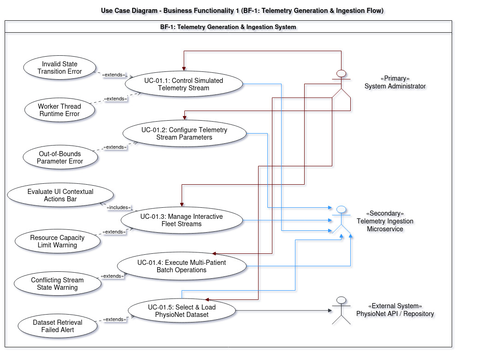
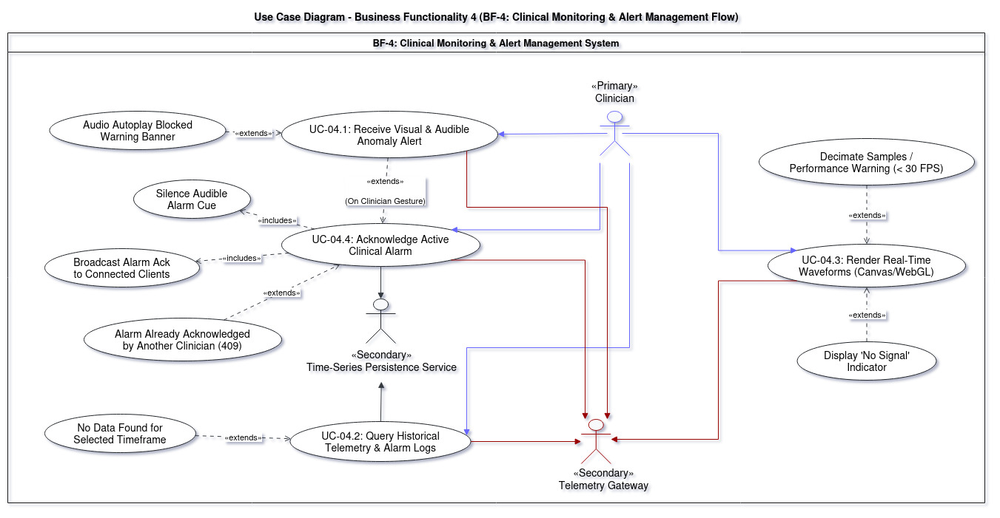
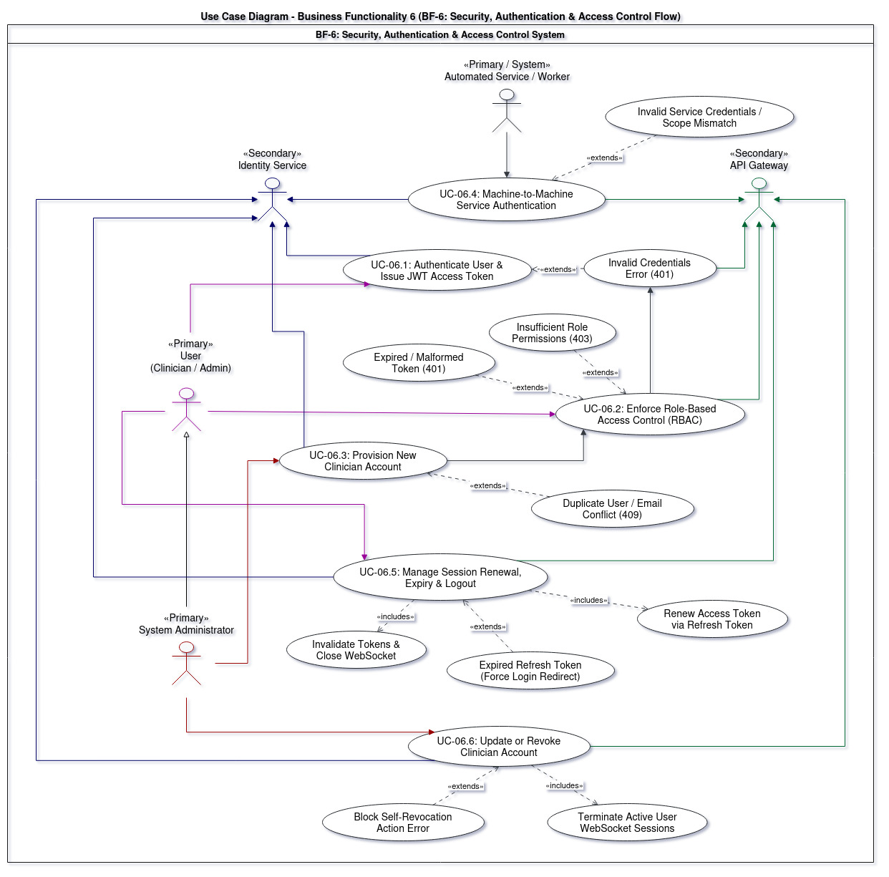

# 🫀 Real-Time Simulation of Ambulatory Patient Monitoring with Lightweight Anomaly Detection

> A containerized, microservice-based framework for real-time simulation of ambulatory patient telemetry, integrated with lightweight unsupervised anomaly detection.
> Master's Thesis in **Computer Engineering** (A.Y. 2026/2027) at the **University of Salerno (UNISA)**, in collaboration with the **Escuela Politécnica de Gijón (University of Oviedo)**.

---

## Table of Contents

- [Author & Supervisors](#author--supervisors)
- [About the Project](#about-the-project)
- [Project Status](#project-status)
- [System Architecture](#system-architecture)
- [Tech Stack](#tech-stack)
- [Use Cases](#use-cases)
- [Datasets](#datasets)
- [Key Features & Quality Targets](#key-features--quality-targets)
- [Quick Start](#quick-start)
- [Git Workflow & Hooks](#git-workflow--hooks)
- [Repository Structure](#repository-structure)
- [Documentation](#documentation)
- [License](#license)

---

## Author & Supervisors

| Role | Name |
|---|---|
| **Author** | Giuseppe Fabrizio Anzivino ([@GiuseppeAnzivino](https://github.com/GiuseppeAnzivino)) |
| **Home Supervisor (UNISA)** | Prof. Pierluigi Ritrovato |
| **Host Supervisor (Escuela Politécnica de Gijón)** | Prof. Victor Manuel Alvarez Garcia |

---

## About the Project

The goal of this thesis is to design, implement, and empirically validate an end-to-end simulation environment that replays clinical physiological signals in real time while detecting arrhythmias and signal artifacts with minimal computational overhead.

The platform provides a reproducible, single-host testbed where real-time streaming pipelines and lightweight Machine Learning detectors can be stressed and evaluated, without physical wearable sensors or live clinical trials.

---

## Project Status

| Phase | Status |
|---|---|
| Planning & requirements analysis | ✅ Completed |
| Architectire Design | 🚧 In progress |
| Implementation | 🚧 In progress |
| Experimental validation | ⏳ Planned |
| Thesis writing & defense | ⏳ Planned |

---

## System Architecture

The platform is a set of decoupled microservices orchestrated with **Docker Compose**. Traffic is split into two planes:

- **Control Plane:** stateless REST over HTTPS.
- **Data Plane:** low-latency, persistent WebSockets over WSS.

| Component | Responsibility |
|---|---|
| **API & WebSocket Gateway** | Single entry point: TLS termination, stateless JWT authentication, Role-Based Access Control (RBAC), WebSocket session multiplexing, Circuit Breaker fault isolation. |
| **Telemetry Ingestion Service** | Python engine that extracts and replays multi-parameter physiological recordings (ECG, SpO₂, Heart Rate) for multiple concurrent simulated patients. |
| **Anomaly Detection Engine** | Lightweight unsupervised ML pipeline (Scikit-Learn / PyTorch) on overlapping sliding windows, flagging clinical anomalies and signal-quality issues in real time. |
| **Time-Series Persistence Layer** | Dedicated storage for continuous telemetry streams and auditable anomaly alert logs. |
| **Monitoring Clients** | Responsive **React** Web Dashboard, decoupled from the backend, with architectural support for an exploratory Unity VR spatial client. |
| **Observability Stack** | Prometheus metrics scraping and Grafana dashboards for CPU, RAM, latency, and throughput. |

---

## Tech Stack

- **Orchestration:** Docker, Docker Compose
- **Backend:** Python
- **Machine Learning:** Scikit-Learn, PyTorch
- **Transport & Security:** REST/HTTPS, WebSocket/WSS, JWT, RBAC
- **Frontend:** React, Unity (exploratory VR client)
- **Observability:** Prometheus, Grafana
- **CI/CD:** GitHub Actions, Postman

---

## Use Cases

The functional requirements are modeled as use case diagrams (BF-1 … BF-6), stored in [`assets/`](assets/).

| | |
|---|---|
|  |  |
|  |  |
|  |  |

---

## Datasets

The simulation engine replays curated, de-identified biomedical recordings from **PhysioNet**. The datasets are not bundled in the repository: they are fetched or mounted locally at runtime.

| Dataset | Signals | Annotations | Role in Platform |
|---|---|---|---|
| **MIT-BIH Arrhythmia Database** | 2-lead ECG (360 Hz) | ~110,000 beat labels | Primary benchmark for ECG rhythm anomaly detection |
| **BIDMC PPG and Respiration** | ECG, PPG, Resp, HR, SpO₂ | Breath annotations | Multi-parameter vital sign streaming |
| **MIT-BIH Polysomnographic** | ECG, EEG, BP, SpO₂ | Beat & apnea labels | Multi-parameter validation with beat-level ground truth |

**Citation:** Goldberger, A., et al. *PhysioBank, PhysioToolkit, and PhysioNet: Components of a New Research Resource for Complex Physiologic Signals.* Circulation 101(23), e215–e220, 2000.

---

## Key Features & Quality Targets

The system is designed and evaluated against the following targets on a single host (`< 4 CPU cores`, `< 4 GB RAM`):

- **Low-latency streaming:** end-to-end delivery from ingestion to browser rendering in `< 500 ms`.
- **Lightweight inference:** sliding-window ML execution in `< 50 ms` per window, with no blocking impact on raw telemetry delivery.
- **Smooth visualization:** waveform rendering at `≥ 30 FPS` (targeting 60 FPS), with automatic exponential-backoff reconnection in `< 2 s`.
- **Scalability:** up to `10–20` concurrent patient streams (0% packet loss) and `50` concurrent WebSocket sessions (`< 100 ms` handshake).
- **Resilience & Security:** Circuit Breaker isolating ML engine failures within `< 100 ms` (auto-recovery in `< 5 s`), stateless JWT + RBAC (`ROLE_CLINICIAN`, `ROLE_ADMIN`), encrypted HTTPS/WSS transport.
- **Automated CI/CD:** GitHub Actions pipeline enforcing linting, static analysis, unit/integration tests, and Postman API validation on every pull request.

---

## Quick Start

> 🚧 **Work in progress**: the implementation phase is ongoing.


### Run

Once implemented, the whole stack will start with a single command:

```bash
git clone https://github.com/GiuseppeAnzivino/rpm-realtime-anomaly-detector.git
cd rpm-realtime-anomaly-detector
docker compose up --build
```

---

## Git Workflow & Hooks

The repository enforces a structured branching and commit strategy through version-controlled Git hooks in `.githooks/`.

### Setup

Enable the project hooks locally after cloning:

```bash
chmod +x .githooks/*
git config core.hooksPath .githooks
```

### Branching Strategy

- **`main`**: stable baseline, documentation (`docs/`), and CI/CD configuration (`.github/`).
- **Working branches** follow the `<type>/<microservice>/<layer>` convention:
  - `<type>`: `feature`, `fix`, `refactor`, `test`
  - `<microservice>`: e.g. `ingestion`, `gateway`, `detector`, `auth`
  - `<layer>`: e.g. `backend`, `frontend`, `infra`
  - Example: `feature/ingestion/backend`

### Active Hooks

| Hook | What it does |
|---|---|
| `pre-commit` | Checks trailing whitespace, blocks accidental private-key commits, validates JSON/YAML/Python syntax, enforces `tests/` naming (`test_*.py`), and rejects TODO/FIXME tags in source code. |
| `prepare-commit-msg` | Pre-fills the commit message template (`<type>(<microservice>/<layer>): <summary>`, `ADDED:`, `CHANGED:`) based on the active branch. |
| `commit-msg` | Validates Conventional Commit format, branch-to-scope consistency, and that no `< >` placeholders are left unfilled. |
| `pre-merge-commit` / `pre-rebase` | Prohibit `git rebase` and enforce non-fast-forward merges (`git merge --no-ff`) to preserve full branch history. |

---

## Repository Structure

```text
rpm-realtime-anomaly-detector/
├── .githooks/            # Version-controlled Git hooks for commit & code quality enforcement
├── assets/               # Use case diagrams (BF-1 … BF-6)
├── docs/                 # Master's Thesis & Planning Document (PDF)
├── frontend/             # Decoupled clients (Web Dashboard, VR Client)
├── infrastructure/       # Reverse proxy configs, TLS scripts, Prometheus & Grafana provisioning
├── microservices/        # Backend services (API Gateway, Auth, Ingestion, Anomaly Detector)
├── tests/                # End-to-end integration tests & Postman collections
├── .gitignore            # Exclusions for datasets, caches, secrets & build artifacts
├── docker-compose.yml    # Orchestration of the whole stack
├── LICENSE               # Proprietary academic license
└── README.md             # Project overview and setup instructions
```

---

## Documentation

- [Planning Document](docs/Planning_Document.pdf)
- [Master's Thesis](docs/Master%27s_Thesis.pdf)

---

## License

This project is released under a **Proprietary Academic License**. See the [LICENSE](LICENSE) file for full terms.

All rights reserved © 2026 Giuseppe Fabrizio Anzivino.