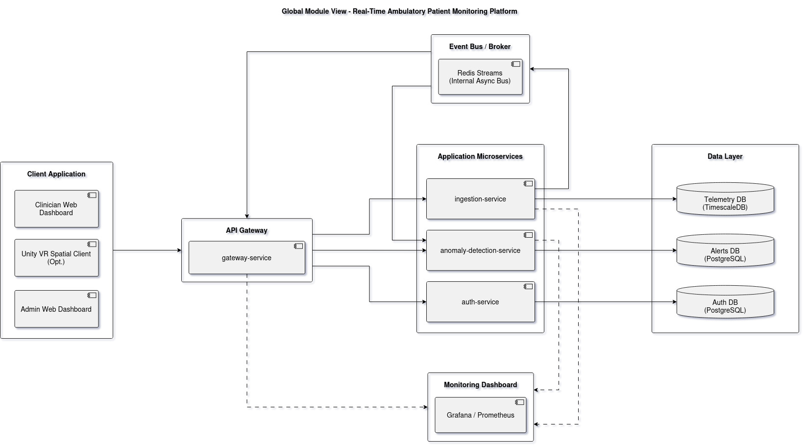
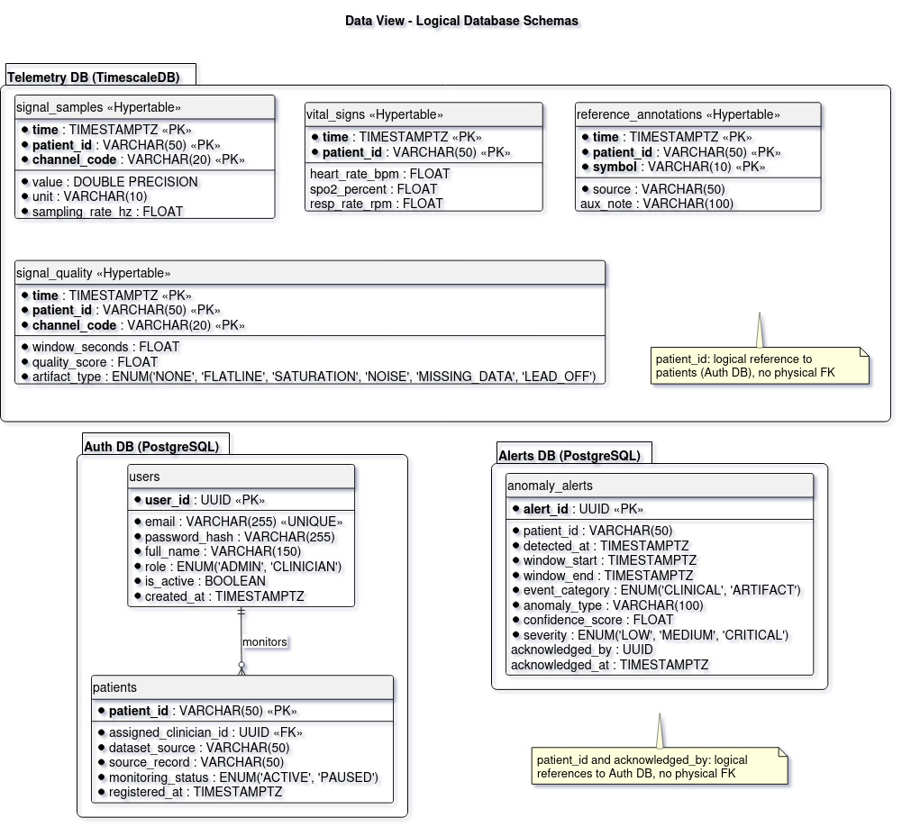
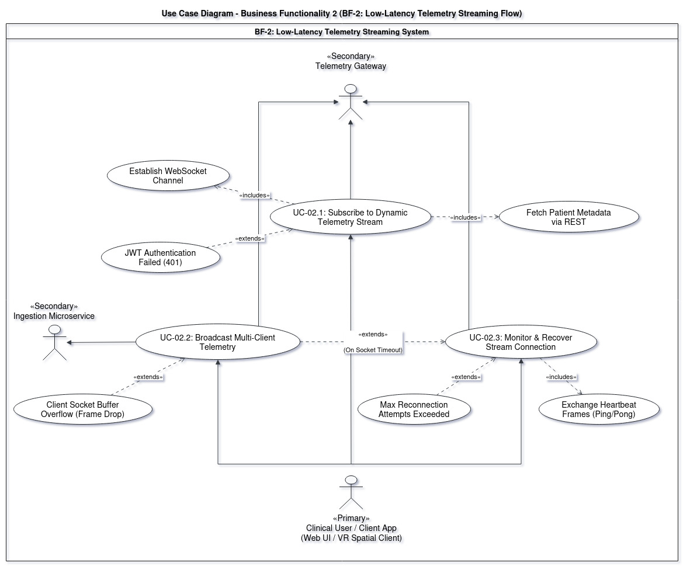
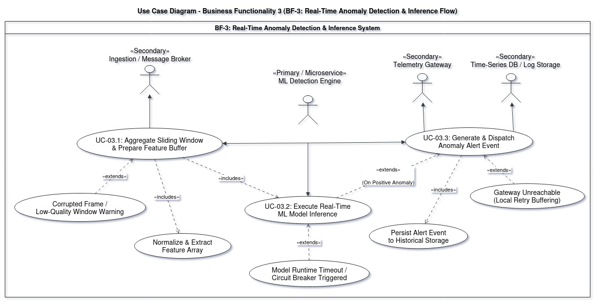
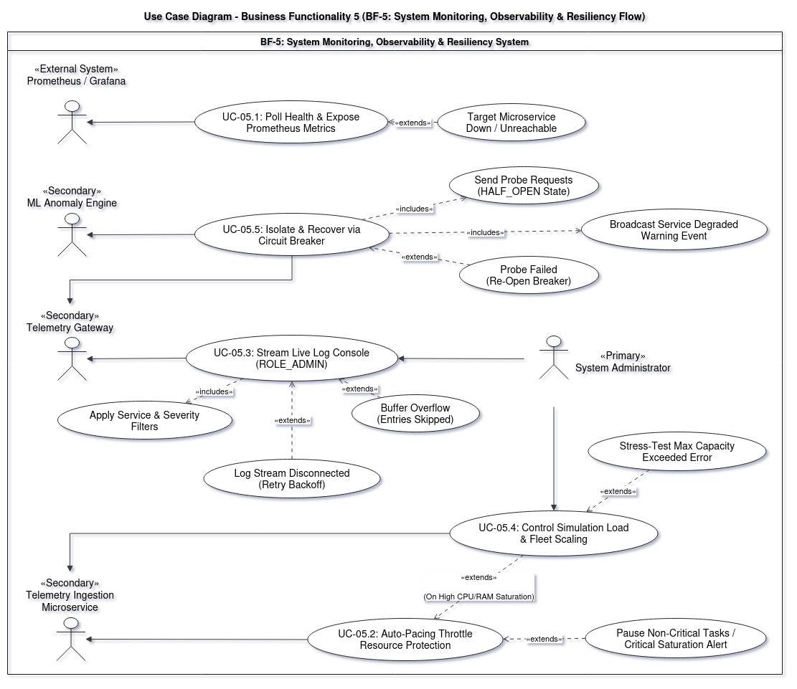

# 🫀 Real-Time Simulation of Ambulatory Patient Monitoring with Lightweight Anomaly Detection

> A containerized, microservice-based framework for real-time simulation of ambulatory patient telemetry, integrated with lightweight unsupervised anomaly detection.
> Master's Thesis in **Computer Engineering** (A.Y. 2026/2027) at the **University of Salerno (UNISA)**, in collaboration with the **Escuela Politécnica de Gijón (University of Oviedo)**.

---

## Table of Contents

- [Author & Supervisors](#author--supervisors)
- [About the Project](#about-the-project)
- [Project Status](#project-status)
- [System Architecture](#system-architecture)
- [Architecture Views](#architecture-views)
- [Tech Stack](#tech-stack)
- [Use Cases](#use-cases)
- [Datasets](#datasets)
- [Key Features & Quality Targets](#key-features--quality-targets)
- [Quick Start](#quick-start)
- [Git Workflow, Hooks & CI](#git-workflow-hooks--ci)
- [Repository Structure](#repository-structure)
- [Documentation](#documentation)
- [License](#license)

---

## Author & Supervisors

| Role | Name |
|---|---|
| **Author** | Giuseppe Fabrizio Anzivino ([@GiuseppeAnzivino](https://github.com/GiuseppeAnzivino)) |
| **Home Supervisor (UNISA)** | Prof. Pierluigi Ritrovato |
| **Host Supervisor (Escuela Politécnica de Gijón)** | Prof. Victor Manuel Alvarez Garcia |

---

## About the Project

The goal of this thesis is to design, implement, and empirically validate an end-to-end simulation environment that replays clinical physiological signals in real time while detecting arrhythmias and signal artifacts with minimal computational overhead.

The platform provides a reproducible, single-host testbed where real-time streaming pipelines and lightweight Machine Learning detectors can be stressed and evaluated, without physical wearable sensors or live clinical trials.

---

## Project Status

| Phase | Status |
|---|---|
| Planning & requirements analysis | ✅ Completed |
| Architecture design | 🚧 In progress |
| Implementation | 🚧 In progress |
| Experimental validation | ⏳ Planned |
| Thesis writing & defense | ⏳ Planned |

---

## System Architecture

The platform is a set of decoupled microservices orchestrated with **Docker Compose**. Traffic is split into two planes:

- **Control Plane:** stateless REST over HTTPS.
- **Data Plane:** low-latency, persistent WebSockets over WSS.

| Component | Responsibility |
|---|---|
| **API & WebSocket Gateway** | Single entry point: TLS termination, stateless JWT authentication, Role-Based Access Control (RBAC), WebSocket session multiplexing, Circuit Breaker fault isolation. |
| **Telemetry Ingestion Service** | Python engine that extracts and replays multi-parameter physiological recordings (ECG, SpO₂, Heart Rate) for multiple concurrent simulated patients. |
| **Anomaly Detection Engine** | Lightweight unsupervised ML pipeline (Scikit-Learn / PyTorch) on overlapping sliding windows, flagging clinical anomalies and signal-quality issues in real time. |
| **Time-Series Persistence Layer** | Dedicated storage for continuous telemetry streams and auditable anomaly alert logs. |
| **Monitoring Clients** | Responsive **React** Web Dashboard, decoupled from the backend, with architectural support for an exploratory Unity VR spatial client. |
| **Observability Stack** | Prometheus metrics scraping and Grafana dashboards for CPU, RAM, latency, and throughput. |

---

## Architecture Views

The architecture is documented through two views, stored in [`assets/views/`](assets/views/). The full description of each one, with its Elements Catalogue and Rationale, is in the thesis documentation.

### Module View

The Module View shows the static structure of the platform: the client applications, the API gateway, the application microservices, the event bus, the data layer and the monitoring stack. Dashed arrows represent the metrics sent to the monitoring stack.



### Data View

The Data View shows the logical schema of each database, following the *database per service* principle: Auth DB, Telemetry DB (TimescaleDB hypertables) and Alerts DB. Relations between different databases are not drawn, because `patient_id` and `acknowledged_by` are logical references checked by the application, not physical foreign keys.



---

## Tech Stack

- **Orchestration:** Docker, Docker Compose
- **Backend:** Python
- **Machine Learning:** Scikit-Learn, PyTorch
- **Transport & Security:** REST/HTTPS, WebSocket/WSS, JWT, RBAC
- **Frontend:** React, Unity (exploratory VR client)
- **Observability:** Prometheus, Grafana
- **CI/CD:** GitHub Actions, Docker Hub, pytest, Postman

---

## Use Cases

The functional requirements are modeled as use case diagrams (BF-1 … BF-6), stored in [`assets/`](assets/).

| | |
|---|---|
|  |  |
|  |  |
|  |  |

---

## Datasets

The simulation engine replays curated, de-identified biomedical recordings from **PhysioNet**. The datasets are not bundled in the repository: they are fetched or mounted locally at runtime. Their structure was verified with a `wfdb` script (`microservices/ingestion-service/tests/test_physionet_dataset.py`).

| Dataset | Signals | Annotations | Role in Platform |
|---|---|---|---|
| **MIT-BIH Arrhythmia Database** | 2-lead ECG (360 Hz) | ~110,000 beat labels | **Primary dataset**: ECG waveform and ground truth for anomaly detection |
| **BIDMC PPG and Respiration** | ECG, PPG, Resp (125 Hz); HR, RR, SpO₂ (1 Hz) | Breath annotations | **Secondary dataset**: multi-parameter vital signs |
| **MIMIC-IV Waveform (subset)** | ECG, Resp (~62.5 Hz, with missing data) | None | Optional: robustness test and future work |
| PTB-XL | 12-lead ECG | CSV labels | Discarded: 10 s records, not continuous |
| MIT-BIH Polysomnographic | ECG, BP, EEG, Resp (250 Hz) | Sleep stages | Discarded: sleep-laboratory setting, not ambulatory |

Simulated patients combine recordings of different people (ECG from MIT-BIH, vital parameters from BIDMC). The platform is a monitoring architecture, not a clinical study.

**Citation:** Goldberger, A., et al. *PhysioBank, PhysioToolkit, and PhysioNet: Components of a New Research Resource for Complex Physiologic Signals.* Circulation 101(23), e215–e220, 2000.

---

## Key Features & Quality Targets

The system is designed and evaluated against the following targets on a single host (`< 4 CPU cores`, `< 4 GB RAM`):

- **Low-latency streaming:** end-to-end delivery from ingestion to browser rendering in `< 500 ms`.
- **Lightweight inference:** sliding-window ML execution in `< 50 ms` per window, with no blocking impact on raw telemetry delivery.
- **Smooth visualization:** waveform rendering at `≥ 30 FPS` (targeting 60 FPS), with automatic exponential-backoff reconnection in `< 2 s`.
- **Scalability:** up to `10–20` concurrent patient streams (0% packet loss) and `50` concurrent WebSocket sessions (`< 100 ms` handshake).
- **Resilience & Security:** Circuit Breaker isolating ML engine failures within `< 100 ms` (auto-recovery in `< 5 s`), stateless JWT + RBAC (`ROLE_CLINICIAN`, `ROLE_ADMIN`), encrypted HTTPS/WSS transport.
- **Automated CI/CD**: GitHub Actions pipeline that checks the tests of every microservice, runs them with a minimum coverage of 80%, publishes its Docker image on every push to main and validates the APIs of the whole stack with Postman collections. Linting and static analysis (Ruff) are planned extensions.

---

## Quick Start

> 🚧 **Work in progress**: the implementation phase is ongoing.

### Run

Once implemented, the whole stack will start with a single command:

```bash
git clone https://github.com/GiuseppeAnzivino/rpm-realtime-anomaly-detector.git
cd rpm-realtime-anomaly-detector
docker compose up --build
```

---

## Git Workflow, Hooks & CI

The repository enforces a structured branching and commit strategy through version-controlled Git hooks in `.githooks/`, and verifies every merge into `main` with a Continuous Integration pipeline.

### Setup

Enable the project hooks locally after cloning:

```bash
chmod +x .githooks/*
git config core.hooksPath .githooks
```

### Branching Strategy

- **`main`**: stable baseline, documentation (`docs/`), and CI/CD configuration (`.github/`). It only receives merges from working branches.
- **Working branches** follow the `<type>/<microservice>/<layer>` convention:
  - `<type>`: `feature`, `fix`, `refactor`, `chore`
  - `<microservice>`: e.g. `ingestion`, `gateway`, `detector`, `auth`
  - `<layer>`: e.g. `backend`, `frontend`, `infra`
  - Example: `feature/ingestion/backend`
- **There are no dedicated test branches.** The tests of a change are written in the same branch as the code they verify, and they are run locally before merging. This way `main` never receives code without its tests, and the CI always validates a feature together with its tests.

Typical flow:

1. Create the working branch from `main`.
2. Implement the change and its tests in the same branch, committing as usual.
3. Run the tests of the microservice locally (`pytest microservices/<service>/tests`).
4. Merge into `main` with `git merge --no-ff <branch>` and push.
5. The CI pipeline starts automatically on the push to `main`.

### Active Hooks

| Hook | What it does |
|---|---|
| `pre-commit` | Checks trailing whitespace, blocks accidental private-key commits, validates JSON/YAML/Python syntax, enforces `tests/` naming (`test_*.py`), and rejects TODO/FIXME tags in source code. |
| `prepare-commit-msg` | Pre-fills the commit message template (`<type>(<microservice>/<layer>): <summary>`, `ADDED:`, `CHANGED:`) based on the active branch. |
| `commit-msg` | Validates Conventional Commit format, branch-to-scope consistency, and that no `< >` placeholders are left unfilled. |
| `pre-merge-commit` / `pre-rebase` | Prohibit `git rebase` and enforce non-fast-forward merges (`git merge --no-ff`) to preserve full branch history. |

The hooks run on the developer's machine and check each commit and merge **before** they are created. They are the first line of defence; the CI described below is the second one and runs remotely, on a clean machine.

### Continuous Integration

The workflow is made of two jobs. The first one uses a build matrix: the same job runs in parallel for each microservice (`auth-service`, `detector-service`, `gateway-service`, `ingestion-service`). A failure in one service does not stop the others (`fail-fast: false`). For each service the job:

1. Checks out the repository and sets up Python 3.12.
2. Checks that `requirements.txt` exists, is not empty and lists `pytest` and `pytest-cov`, then installs the dependencies.
3. Runs `.github/scripts/check_tests.py`, which verifies that every source file in `src/` has a matching `test_<name>.py` file in `tests/`.
4. Runs `pytest` on the service's `tests/` folder with coverage. The step fails if no test is found or if the coverage is below 80%.
5. Logs in to Docker Hub with the `DOCKERHUB_TOKEN` repository secret.
6. Builds the Docker image of the service and pushes it to Docker Hub with two tags: `latest` and the commit SHA (e.g. `<user>/rpm-auth-service:latest` and `<user>/rpm-auth-service:<sha>`).

The second job, `api-tests`, starts only if all services passed. It starts the whole stack with Docker Compose, waits for the gateway to be ready and runs the Postman collections with Newman.

If a check or a test of a service fails, its image is not built or published. Since the pipeline runs after the merge, the tests should be executed locally before merging, as described in the workflow above.

The frontend is not yet part of the pipeline.

---

## Repository Structure

```text
rpm-realtime-anomaly-detector/
├── .githooks/                  # Version-controlled Git hooks (commit & code quality enforcement)
│   ├── commit-msg
│   ├── pre-commit
│   ├── pre-merge-commit
│   ├── pre-rebase
│   └── prepare-commit-msg
├── .github/
│   ├── workflows/
│   │   └── ci.yml              # CI/CD pipeline: checks, tests and Docker image publishing
│   └── scripts/
│       └── check_tests.py      # Verifies that every source file has a matching test file
├── assets/
│   ├── use-case-diagram/       # Use case diagrams (BF-1 … BF-6)
│   └── views/                  # Architecture views (module-view.jpg, data-view.jpg)
├── docs/                       # Master's Thesis & Planning Document (PDF)
├── frontend/                   # Decoupled clients (Web Dashboard, VR Client)
│   ├── public/
│   ├── src/
│   ├── tests/
│   └── Dockerfile
├── microservices/              # Backend services
│   ├── auth-service/           # Each service has the same layout:
│   │   ├── src/                #   source code
│   │   ├── tests/              #   unit tests (run by the CI)
│   │   ├── Dockerfile
│   │   └── requirements.txt
│   ├── detector-service/       # Anomaly detection engine
│   ├── gateway-service/        # API & WebSocket gateway
│   └── ingestion-service/      # Telemetry ingestion and replay
├── .gitignore                  # Exclusions for datasets, caches, secrets & build artifacts
├── docker-compose.yml          # Orchestration of the whole stack
├── LICENSE                     # Proprietary academic license
└── README.md                   # Project overview and setup instructions
```

---

## Documentation

- [Planning Document](docs/planning_document.pdf)
- [Master's Thesis](docs/master%27s_thesis.pdf)

---

## License

This project is released under a **Proprietary Academic License**. See the [LICENSE](LICENSE) file for full terms.

All rights reserved © 2026 Giuseppe Fabrizio Anzivino.